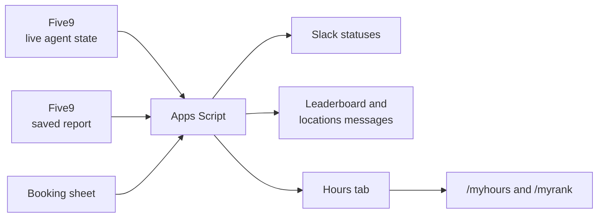

# Five9 to Slack sync

Puts a call center's Five9 activity into Slack, so the team can see who's on a call, how many hours they've logged, and who's booking the most, without anyone opening Five9.

It's one Google Apps Script file attached to a Google Sheet. No server, and nothing extra to pay for.

## What it does

| Job | How often | What happens |
|---|---|---|
| Status sync | Every minute | Reads each agent's live state from Five9 and sets their Slack status to Working, Wrapping up or Not active |
| Hours cache | Every 15 minutes | Runs a saved Five9 report and stores each agent's talk and wait time for the day and the week |
| Boards | Every 30 minutes | Updates a booking leaderboard and a list of active locations, each as one Slack message that gets edited in place |
| `/myhours` | On demand | Shows an agent their own hours, only to them |
| `/myrank` | On demand | Shows an agent where they stand on the leaderboard |

## What I did to keep it reliable

A lot of this script is about what happens when something goes wrong.

- Two runs can't overlap. Every scheduled job takes a script lock first and skips its turn if another run still has it.
- It only calls Slack when a status changed. Every 15 minutes it pushes everyone again anyway, in case Slack and the sheet have drifted apart.
- The status sync writes back only the two columns it owns. The Five9 round trip takes a few seconds, and writing the whole row back would wipe out any edit someone made to the sheet in that time.
- Passwords and tokens live in Script Properties. Pasting a new version of the file can't erase them, and they aren't in the code.
- The slash commands answer from a cache. Slack gives you 3 seconds to reply, and opening the booking sheet takes longer than that.
- The two boards fail separately. A bad tab in the booking sheet can't take the locations board down with it.
- Unknown Five9 states get logged and treated as Not active, so a new state shows up in the log before it causes a problem.
- It only runs on weekdays during working hours, so it isn't calling Five9 all night.

## Problems I ran into

Hours showed up in Slack as dates from 1899. Google Sheets reads a string like `0:03:40` as a time of day and hands it back as a date. The fix was to store plain seconds and format them only when they go out to Slack.

The booking sheet has no timestamp on a booking, so there was no way to ask how many came in today. The script takes a snapshot of everyone's count on the first run of each day and subtracts it from the current count.

Slack turned every Google Maps link on the locations board into a preview card and buried the board. Link previews are switched off on those messages now.

## Setup

The full checklist is at the bottom of [`Code.gs`](Code.gs). The short version:

1. Create a Google Sheet, open Extensions, then Apps Script, and paste in `Code.gs`.
2. Run `setupSheet()` to create the tabs.
3. Fill in the Agents tab with each person's Five9 username and Slack member ID, and the StateMap tab with which Five9 states count as Working or Wrapping up.
4. Put your Five9 login and Slack tokens into `saveSecrets()` and `saveBotToken()`, run each once, then wipe the values out of the file.
5. Replace `YOUR_BOOKING_SHEET_ID` and `YOUR_WEBSITE_SHEET_ID` in the config.
6. Deploy as a web app and point the `/myhours` and `/myrank` slash commands at its URL.
7. Run `installTriggers()`.

## Built with

Google Apps Script, the Five9 Supervisor and Admin web services (SOAP), the Slack Web API, and Google Sheets.
